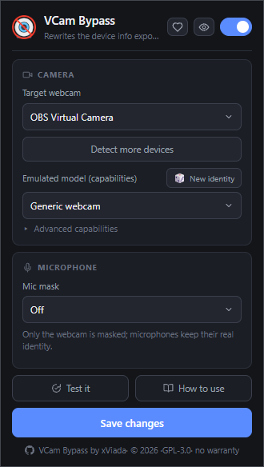
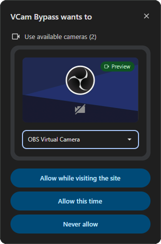

  

<h1 align="center">VCam Bypass</h1>

<strong>Make any virtual camera look like a real webcam to websites.</strong>

  
  
  
  
  
  

  
  
  
  

  <a href="https://xviada.github.io/VCam-Bypass/"><strong>Website</strong></a> ·
  <a href="https://github.com/xViada/VCam-Bypass/releases/latest"><strong>Download</strong></a> ·
  <a href="#quick-start"><strong>Quick start</strong></a> ·
  <a href="https://github.com/xViada/VCam-Bypass/issues"><strong>Report a bug</strong></a> ·
  <a href="https://xviada.github.io/VCam-Bypass/donate/"><strong>Donate</strong></a>

  

---

## Features

- 🎥 **Works with any virtual camera:** OBS Virtual Camera, ManyCam, DroidCam,
  iVCam, Snap Camera and more.
- 🏷️ **Real webcam identity:** realistic name, `deviceId` and `groupId`.
- ⚙️ **Real hardware capabilities:** emulates Logitech, Microsoft and laptop
  webcams down to focus, exposure and white balance.
- 🎙️ **Matching microphone:** passes your mic off as the webcam's built-in one.
- 🙈 **Hide other devices:** sites only see the emulated camera and mic.
- 🧪 **Built-in test page:** see exactly what a website sees.
- 🔒 **Private:** everything stays in your browser.

## What it does

It rewrites what the browser reports about the device (`label`, `deviceId`,
`groupId`, `getSettings()` and `getCapabilities()`) so it matches a real webcam
model, including its resolution, frame rate, focus, exposure, white balance and
image controls. It can mask the **microphone** the same way, so the pair looks
like a webcam with a built-in mic.

Everything runs in JavaScript inside the page. The extension doesn't touch the
operating system or the video itself.

## Installation

1. Download or clone this repository (or grab the latest
   [release](https://github.com/xViada/VCam-Bypass/releases/latest)).
2. Make sure your virtual camera is **installed and running**.
3. Open `chrome://extensions` and turn on **Developer mode** (top right).
4. Click **Load unpacked** and select the project folder.
5. Pin the extension so the popup is easy to reach.

Requires Chrome 111 or later, or another Chromium-based browser (Edge, Brave,
Opera…).

## Quick start

1. Open the popup and click **Detect cameras**. A tab opens asking for
   camera/microphone permission. Click **Allow**.

2. Pick your virtual camera in **Target webcam**.
3. Choose an **Emulated model**, or click **New identity** for a random,
   consistent one.
4. (Optional) Set the **Mic mask** and pick a **Target microphone**.
5. Turn the mask **on** and save.
6. Click **Test it** to see exactly what a website sees.
7. **Reload** any page that uses the camera. The changes only apply after a
   reload.

The site's camera list will now show something like
`Integrated Webcam (1bcf:2b95)`, the `name (vendor:product)` format Chrome uses
for real USB webcams. The **How to use** button in the popup opens the
[illustrated guide](https://xviada.github.io/VCam-Bypass/guide/).

## Support

Found a bug or have an idea? [Open an issue](https://github.com/xViada/VCam-Bypass/issues).

If the project is useful to you, a ⭐ on GitHub helps a lot. You can also
support it on Ko-fi or GitHub Sponsors, or donate with cryptocurrency on the
donation page:

  
  
  

## Options

| Option | What it does |
| --- | --- |
| **Enabled** | Turns the mask on or off. Needs a target webcam first. |
| **Hide other devices** (eye icon) | Sites only see the emulated camera and mic. Other devices are removed from the list, and requests that don't name a device go to the emulated one. Speakers are left alone. |
| **Target webcam** | The real (virtual) camera to mask. Filled in by **Detect cameras** and by sites where you already allowed the camera. |
| **Emulated model** | The real webcam to imitate: Logitech C920, C922 Pro, BRIO, Microsoft LifeCam HD-3000, an integrated laptop webcam or a generic one. Your real resolution and frame rate are kept, so they match the actual video. |
| **New identity** | Picks a model with a matching name and new random `deviceId` / `groupId`. |
| **Advanced capabilities** | Edit the name, IDs and every capability by hand. Any change switches the model to **Custom**. Values are checked and clamped on save. |

The `deviceId` / `groupId` are random 64-character hex strings, like Chrome's
real IDs. They stay the same until you generate a new identity.

### Microphone

| Mic mask | Behaviour |
| --- | --- |
| **Off** *(default)* | Microphones are left untouched. |
| **Auto** | The selected mic becomes the emulated webcam's built-in mic: same `groupId` and a matching label, e.g. `Microphone (Integrated Webcam) (1bcf:2b95)`. |
| **Custom** | Same as Auto, but with a name and IDs you choose. |

Only the mic you select as **Target microphone** is masked. The mask can't be
turned on with a mic mode set until one is selected.

## Troubleshooting

- **Nothing changes on the site:** reload the page after saving, and check the
  mask is enabled with a target selected.
- **The target list is empty:** start the virtual camera, then click
  **Detect cameras** again.
- **The site still shows other cameras:** turn on **Hide other devices**.
- **Not sure it works:** use **Test it**. It shows the label, IDs, settings and
  capabilities exactly as a page receives them.

## Limitations

- It only changes what web pages see through the browser's media APIs.
  Desktop apps and the video content itself are not affected.
- It doesn't run on browser-internal pages (`chrome://`, the Chrome Web Store).
- Detection methods that don't rely on these APIs (analysing the video image,
  for example) are out of scope.

## Privacy

- Your settings are stored locally with `chrome.storage`. Nothing is sent
  anywhere.
- The only network request is a check against the GitHub Releases API
  (`api.github.com`) when the browser starts, to show a badge if a new version is
  available.
- The content scripts run on all sites, because any site may ask for your
  camera.

## How it works

| File | Role |
| --- | --- |
| `manifest.json` | Extension definition and content-script registration. |
| `inject.js` | Runs in the page (MAIN world) at `document_start`. Patches `enumerateDevices()`, `getUserMedia()` (and legacy variants), and `MediaStreamTrack.getSettings()` / `getCapabilities()`. Translates fake IDs back to real ones before opening the device. |
| `profiles.js` | Capability profiles of real webcams and the builders for the spoofed settings and capabilities. Shared by the page, popup and service worker. |
| `bridge.js` | Runs in the ISOLATED world. Passes the config from `chrome.storage` to `inject.js` and collects the camera names a page can see. |
| `background.js` | Service worker. Generates the identity on install and checks for updates. |
| `popup.html` / `popup.js` | Configuration UI. |
| `request.html` / `request.js` | Asks for camera/mic permission to read the real device names. |
| `test.html` / `test.js` | Test page that loads the same scripts as a real site and shows what it sees. |
## Official builds

The only official source of VCam Bypass is
[github.com/xViada/VCam-Bypass](https://github.com/xViada/VCam-Bypass). Copies
published in extension stores by others are not made or endorsed by me. If you
find one that hides where it comes from, please open an issue.

## License

Copyright (C) 2026 [xViada](https://github.com/xViada). Licensed under the
[GNU GPL v3.0](LICENSE) with additional terms under Section 7. In short, you can
use, study, modify and share it, as long as any version you distribute:

- is also GPL v3, with its source code available;
- keeps the attribution "Based on VCam Bypass by xViada — https://github.com/xViada/VCam-Bypass"
  (in the UI, a visible "VCam Bypass by xViada" credit linking to the repository,
  with the full line as the link's title);
- uses its own name, icon and extension ID, and isn't presented as the original
  or as endorsed by me.

No trademark rights are granted in the name "VCam Bypass", the handle "xViada" or
the project logos. See [ADDITIONAL-TERMS.md](ADDITIONAL-TERMS.md) for the exact
terms.

## Disclaimer

This software comes with no warranty. The author is not responsible for how it is
used. You are responsible for following the laws and the terms of service of the
sites you use it on.
